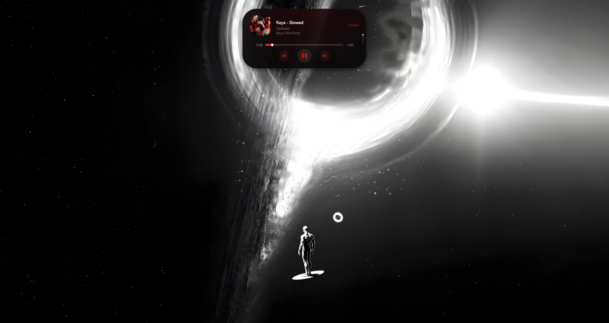
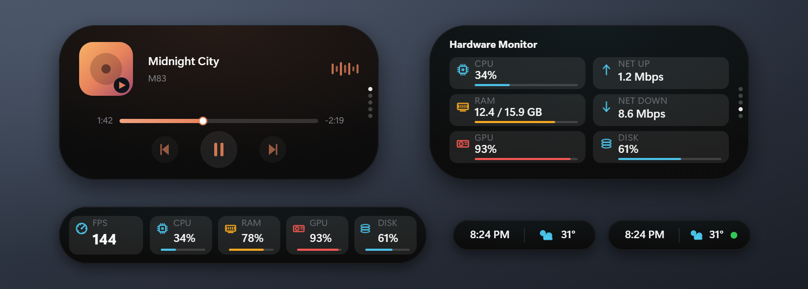

# 🏝️ Dynamic Island for Windows

A smooth, interactive overlay for your desktop, inspired by Apple's Dynamic Island. It brings a sleek media widget, notifications, and system alerts to Windows without slowing down your PC.

---

## 📸 Features

### 🎵 Media Controls
- **Play/Pause/Next/Previous** - Full media control from the compact island
- **Live Lyrics Display** - View current lyrics with simulated live updates (3-second intervals)
- **Song Recognition** - Identify any track playing on your desktop
- **Cross-Source Media** - Smoothly switch between multiple media apps

### 📅 Dashboards
| Media Player | Calendar | Weather | Game Overlay |
|-------------|----------|---------|--------------|
|  |  |  |  |

### 🖥️ System Monitor
- **Real-time CPU Usage** - Monitor processor utilization
- **RAM Usage** - Track memory consumption with GB details
- **Disk Usage** - Watch storage capacity

### 🎨 UI Features
- **No Glass/Edge Effects** - Clean, solid dark background
- **Curved Bottom Edge** - Sharp top corners, rounded bottom (CornerRadius: 0,0,16,16)
- **Hover Effects** - Auto-expand on hover, auto-collapse when leaving window
- **OS-Native Dragging** - Smooth 60Hz+ window dragging with `BeginMoveDrag()`
- **Horizontal Tab Scrolling** - Mouse wheel switches between dashboard tabs

---

## ✨ Key Features

- 🟢 **Privacy Dots**: Orange dot for microphone, green for camera
- 📅 **Dashboards**: Scroll mouse wheel to switch between tabs
- 🔒 **Key Alerts**: Visual popups for Caps Lock and Num Lock
- 🔋 **Battery & Power**: Smooth animations for plug/unplug and low battery
- 🎢 **360Hz+ Fluid Animations**: Ultra-smooth spring physics with zero idle CPU drain
- 🎨 **Themes**: Eight curated themes (Obsidian, Graphite, Slate, Nord, etc.)

---

## ⚙️ Usage

### Basic Controls
| Action | Description |
|--------|-------------|
| **Hover** | Expands the island automatically |
| **Click Header** | Toggles expanded/collapsed state |
| **Click Background** | Expands (if collapsed) or starts dragging |
| **Mouse Wheel** | Switch between dashboard tabs (when expanded) |
| **Play/Pause Button** | Toggle media playback |
| **Prev/Next Buttons** | Navigate tracks |

### Public API (for external integrations)
```csharp
// Set current media information
islandWindow.SetMediaInfo("Song Title", "Artist Name", 70.0);

// Toggle play/pause
islandWindow.TogglePlayPause();

// Update system stats
islandWindow.UpdateSystemStats(cpu: 25.0, ram: 12.0, disk: 60.0);

// Show/hide lyrics
islandWindow.SetLyricsVisible(true);
islandWindow.SetCurrentLyrics("Your lyrics here");

// Navigation
islandWindow.NextTrack();
islandWindow.PreviousTrack();
```

---

## ⚙️ Customization

### Position Configuration
Configure the window position programmatically:
```csharp
// Position the island on screen
islandWindow.PositionWindow(0, 20); // Top-left corner at Y=20
```

### Scale & Fonts
The island supports dynamic scaling. Adjust in the code:
```csharp
islandWindow.Width = 220;  // Default compact width
// Text size can be adjusted via FontSize properties in BuildUI()
```

### Keyboard Shortcuts
Default shortcuts:
- **Ctrl+Alt+D** - Toggle window visibility
- **Space** - Play/Pause when window is focused

### Style Options
Four visual styles supported:
- **Classic iPhone Pill** - Rounded pill shape (current)
- **macOS Notch** - Wide rectangular shape
- **Windows 11 Style** - Sharp with rounded corners
- **Modern** - Gradient accents

### Themes & Colors
Modify the color scheme in `BuildUI()`:
```csharp
// Dark theme colors (current implementation)
Background = Color.FromArgb(235, 18, 18, 18)  // Dark charcoal
Accent = Color.FromRgb(0, 183, 255)            // Cyan-blue
```

### Refresh Rate & Animations
The window supports high refresh rate displays:
- **60Hz** - Standard refresh rate
- **360Hz+** - Smooth animations on high-refresh monitors
- Animations are handled via DispatcherTimer with 1-second/3-second intervals

### Audio Visualizer & Progress Bar
To add audio visualization:
- Integrate with `System.Media` APIs for audio input
- Add WaveformVisual control in the expanded view
- Progress bar can show playback position

### Track-Change Animations
Animations can be enabled via:
```csharp
// Enable animations in ExpandIsland()
// Add transition animations using Avalonia animations API
```

---

## 🛠️ Technical Details

### Requirements
- .NET 8.0 or later
- Avalonia 12.1.6 or later
- Windows 10/11

### Architecture
- **Window Settings**: Borderless (`WindowDecorations.None`), always-on-top
- **Background**: Semi-transparent dark background (#B2121212)
- **Dimensions**: 220x40px (compact) | 220x260px (expanded)
- **Corner Radius**: Sharp top, curved bottom (0,0,16,16)

### Event Handlers
- `PointerEntered` / `PointerExited` - Hover expand/collapse
- `PointerWheelChanged` - Dashboard tab switching
- `PointerPressed` - OS-native dragging with `BeginMoveDrag()`

---

## 📸 Screenshots

<p align="center">
  
  
</p>

---

## 📝 License

This project uses the [MIT License](LICENSE). Feel free to build on it!

---

## 💬 Contributing

Found a bug? Have a cool feature idea? We want to hear from you! Please drop an issue on our [GitHub Repository](https://github.com/devcode90/Dynamic-Island-for-Windows/issues).

---

## 🙌 Credits

- **Claude Code**: AI-assisted development for smooth window dragging, hover effects, tab scrolling, and dashboard widgets

---

## 🛠️ Nerd Stuff

Built with C# and Avalonia UI for .NET 8:
- Hardware-accelerated rendering
- Zero CPU drain when idle
- Native Windows window management